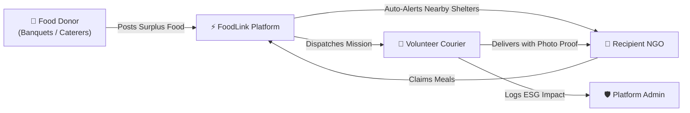
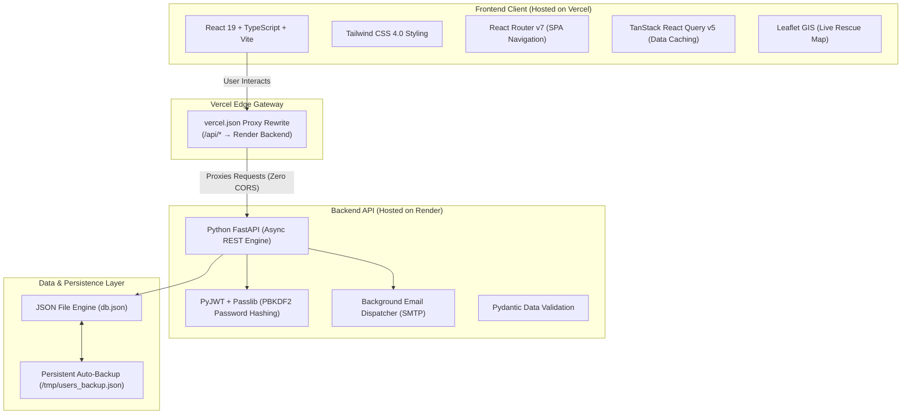

# FoodLink (Surplus to Share) — Technical Architecture & Operational Guide

> A complete, beginner-friendly technical explanation of how the FoodLink food rescue platform is built, how its components interact, and how to present it effectively to others.

---

## 1. Executive Summary & Problem Statement

### The Problem
India produces millions of tons of high-grade food waste annually—especially from large banquets, weddings, conventions, and corporate caterers—while shelters, orphanages, and community kitchens struggle for nutritious daily meals. The primary barrier is not food shortage; it is **rapid logistics and information asymmetry**. Cooked food spoils rapidly, so traditional donation processes taking 4–6 hours result in discarded food.

### The FoodLink Solution
**FoodLink** is a **hyperlocal real-time surplus food rescue exchange** operating under a **< 30-minute SLA (Service Level Agreement)**. It bridges banquet providers directly with verified NGOs and volunteer couriers via real-time mapping, automated notifications, and digital handover proofs.



---

## 2. High-Level System Architecture

The project is built as a **decoupled modern web application**:



### Why this architecture was chosen:
1. **Speed & Lightweight Footprint**: Vite compiles and bundles the React frontend in milliseconds.
2. **Type Safety**: TypeScript on the frontend and Pydantic models on the backend ensure that data models match across the entire stack.
3. **Zero Deployment Costs**: Vercel provides a free global CDN for the frontend, while Render runs the Python FastAPI service for free.
4. **Vercel Proxy Rewrite**: Instead of calling `https://surplus-to-share.onrender.com` directly from the browser (which can trigger browser third-party cookie restrictions), Vercel forwards `/api/*` requests on the server side. To the user's browser, the frontend and backend appear on the exact same domain (`surplus-to-share.vercel.app`).

---

## 3. The 4 Stakeholder Roles (Personas)

The platform is designed around 4 distinct user workflows:

| Role | Target User | Key Actions & Pages |
| :--- | :--- | :--- |
| **1. Food Donor** (`provider`) | Hotels, Banquet Halls, Wedding Caterers | • Post surplus food with portions, category, temperature, and pickup window.<br>• View live pickup status of their donations.<br>• Access the 24/7 Rapid Emergency Hotline (`+91 98000 91000`). |
| **2. Recipient NGO** (`recipient`) | Orphanages, Old-Age Homes, Shelters | • Explore available surplus listings filtered by category and city.<br>• Request specific meal percentages (25%, 50%, 75%, 100%).<br>• View assigned courier name and click **`📞 Call Courier`**.<br>• Track courier arrival on live map and sign off on deliveries. |
| **3. Volunteer Courier** (`volunteer`) | Two-wheeler riders, Van drivers, Citizens | • View approved pickup requests ready for dispatch in their city.<br>• Accept delivery missions.<br>• Live GPS location sharing.<br>• Upload photo proof of handover upon arrival at the shelter. |
| **4. Platform Admin** (`admin`) | Operations Director, FSSAI Compliance Officer | • Mission control dashboard with live platform KPIs.<br>• Review, approve, or re-route emergency food requests.<br>• Live email audit logs (monitoring automated dispatch alerts).<br>• One-click export of ESG analytics in Excel (`.xlsx`) and JSON format. |

---

## 4. Operational Workflow (The 5-Stage Life Cycle)

```mermaid
sequenceDiagram
    autonumber
    actor Donor as 👑 Food Donor
    participant System as ⚡ FoodLink Engine
    actor NGO as 🏢 Recipient NGO
    actor Courier as 🛵 Volunteer Courier
    actor Admin as 🛡️ Admin

    Donor->>System: 1. Post surplus food (e.g., 150 meals in Jaipur)
    System->>NGO: 2. Auto-dispatch email alert to all nearby NGOs
    NGO->>System: 3. Claims meals (e.g., 100 meals for shelter)
    System->>Courier: 4. Auto-dispatch email to nearby couriers
    Courier->>System: 5. Accepts mission; initiates pickup
    Courier->>NGO: 6. Transports food & delivers packages
    Courier->>System: 7. Uploads photo proof & marks "Delivered"
    System->>Admin: 8. Auto-dispatch confirmation email to Admin
```

---

## 5. Technical Highlights & How They Work

### 1. Dual-Layer Persistent Authentication
- **The Challenge**: Cross-site cookies between separate frontend (Vercel) and backend (Render) domains are often blocked by modern browsers (Safari ITP, Chrome Privacy Sandbox).
- **The FoodLink Solution**:
  - The backend returns both an `HttpOnly; SameSite=None; Secure` session cookie AND a raw JWT token in the JSON response.
  - The frontend saves the token in browser `localStorage` (`foodlink_token`).
  - The centralized fetch client (`src/lib/api.ts`) automatically sends `Authorization: Bearer <token>` alongside `credentials: "include"` on every request.
  - **Result**: Users remain logged in permanently across tab closes, browser restarts, and mobile devices.

### 2. GIS & Live Rescue Map (Leaflet + OpenStreetMap)
- Uses `react-leaflet` connected to open-source **OpenStreetMap** tile servers (no paid Google Maps API keys required).
- Includes deterministic coordinate jittering: when multiple banquets or couriers are registered in the same city (e.g., Jaipur, Bengaluru), coordinates are intelligently offset by a minute fraction (`~0.01°`) so markers do not visually overlap.
- Features one-click **Turn-by-Turn Google Maps Navigation** links (`directionsUrl`) for couriers on smartphones.

### 3. Automated Email Notification Engine
- Built in `backend/notifications.py` using Python's standard `smtplib` and `email.mime` modules.
- **Asynchronous & Non-Blocking**: Dispatches emails via background daemon threads (`threading.Thread`), ensuring that HTTP responses return to the user in milliseconds without waiting for SMTP handshakes.
- **Graceful Fallback**: If live SMTP credentials are not yet configured in environment variables, the system safely records and logs every message in `db.json` and displays them in the Admin Dashboard's **Automated Emails** tab.

### 4. ESG Impact & Environmental Calculation Algorithms
The platform calculates verified environmental impact in real-time based on standard Indian sustainability metrics:

$$\text{Landfill Diversion (kg)} = \text{Rescued Meals} \times 0.35\text{ kg/meal}$$

$$\text{GHG Avoided (kg CO}_2\text{e)} = \text{Landfill Waste (kg)} \times 2.5$$

$$\text{Agricultural Freshwater Conserved (Litres)} = \text{Rescued Meals} \times 150\text{ Litres}$$

- **Equivalency Calculations**: Translates raw data into intuitive milestones (e.g., *Equivalent to 285,000 km driven by a car* or *Equal to planting 3,420 mature trees*).

---

## 6. Project Directory Structure

```
surplus-to-share/
├── backend/                         # FastAPI Python Server
│   ├── data/
│   │   ├── db.json                  # Live JSON database
│   │   └── backup-full.json         # Seed template
│   ├── notifications.py             # Asynchronous HTML email dispatcher
│   ├── server.py                    # Complete REST API (Auth, Donations, Map, Admin)
│   └── requirements.txt             # Python package dependencies
│
├── frontend/                        # React 19 Frontend
│   ├── src/
│   │   ├── components/
│   │   │   ├── layout/Navbar.tsx    # Responsive navigation & emergency hotline modal
│   │   │   ├── layout/Footer.tsx    # SLA badge & active hub listing
│   │   │   └── requests/            # Tracking dialog & courier contact cards
│   │   ├── pages/
│   │   │   ├── Home.tsx             # Hero, ESG counters, 5-step pipeline, rescue board
│   │   │   ├── MapPage.tsx          # Interactive GIS rescue map with courier pins
│   │   │   ├── ProviderDashboard.tsx# Food Donor listing manager
│   │   │   ├── RecipientDashboard.tsx# Shelter meal claims & courier contact
│   │   │   ├── VolunteerDashboard.tsx# Courier mission board & photo proof upload
│   │   │   └── AdminDashboard.tsx   # Mission control & automated email audit feed
│   │   ├── lib/
│   │   │   ├── api.ts               # Dual-layer fetch client (JWT + cookie)
│   │   │   ├── constants.ts         # Categories, cities (including Jaipur), roles
│   │   │   └── geo.ts               # City coordinates & turn-by-turn routing
│   │   └── App.tsx                  # Main router configuration
│   ├── vercel.json                  # Single-Page-App rewrite & Render API proxy
│   └── package.json                 # Frontend dependencies
│
├── setup.bat                        # 1-click Windows dependency installer
├── start.bat                        # 1-click local launcher for both servers
└── README.md                        # Quickstart documentation
```

---

## 7. Presentation & Explanation Cheat Sheet

When explaining this project to a professor, client, or your friend:

### 30-Second Elevator Pitch
> *"FoodLink is a real-time surplus food rescue platform designed to eliminate banquet and wedding food waste. When a caterer has untouched surplus food, they post it on FoodLink. The system immediately alerts nearby shelters and orphanages by email. Once a shelter claims the food, nearby volunteer couriers receive an alert, pick up the hot containers within 30 minutes, and deliver them with photo proof. Every meal rescued automatically calculates carbon offsets and water conserved."*

### 3 Key Technical Selling Points to Highlight:
1. **Decoupled Architecture with Zero CORS Issues**: We deployed the frontend on Vercel and backend on Render, and resolved cross-domain communication using Vercel serverless proxy rewrites.
2. **Dual-Layer Authentication Resilience**: To guarantee users never get logged out by browser cookie blocks, we engineered a fallback authentication layer pairing secure HTTP cookies with client-side JWT authorization headers.
3. **Automated Event-Driven Pipeline**: Using asynchronous background threads, three automated notifications fire during a donation's lifecycle (Surplus Posted $\rightarrow$ NGO Claimed $\rightarrow$ Food Delivered).
